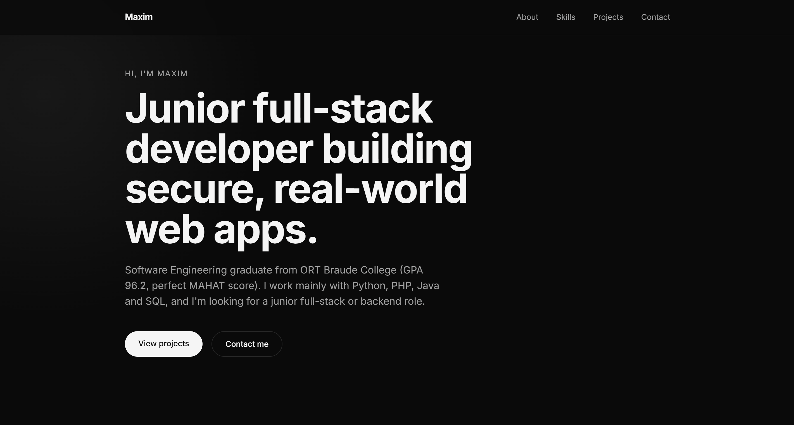

# Maxim Banna – Portfolio

My personal portfolio website, built with React, Tailwind CSS and Motion.

**Live site:** [portfolio-zeta-black-31.vercel.app](https://portfolio-zeta-black-31.vercel.app)



## Features

- Responsive dark, minimal design
- Animated hero and scroll-reveal sections
- Mouse-following cursor glow (desktop only)
- Mobile navigation menu
- Skill pills with technology icons
- Content kept in data files (`src/data`), separate from the components
- Respects the "reduce motion" accessibility setting

## Built with

- [React](https://react.dev) and [Vite](https://vite.dev)
- [Tailwind CSS](https://tailwindcss.com)
- [Motion](https://motion.dev)
- [Lucide](https://lucide.dev) and [React Icons](https://react-icons.github.io/react-icons/)

## Run locally

```bash
npm install
npm run dev
```

Then open the address shown in the terminal (usually http://localhost:5173).

## Project structure

```
src/
├── components/
│   ├── layout/     Navbar, Footer
│   ├── sections/   Hero, About, Skills, Projects, Contact
│   └── ui/         Button, SectionHeading, ProjectCard, Reveal, CursorGlow
└── data/           skills, skillIcons, projects
```

## Contact

- GitHub: [MaximBanna](https://github.com/MaximBanna)
- LinkedIn: [maxim-banna](https://www.linkedin.com/in/maxim-banna-38232b29b)
